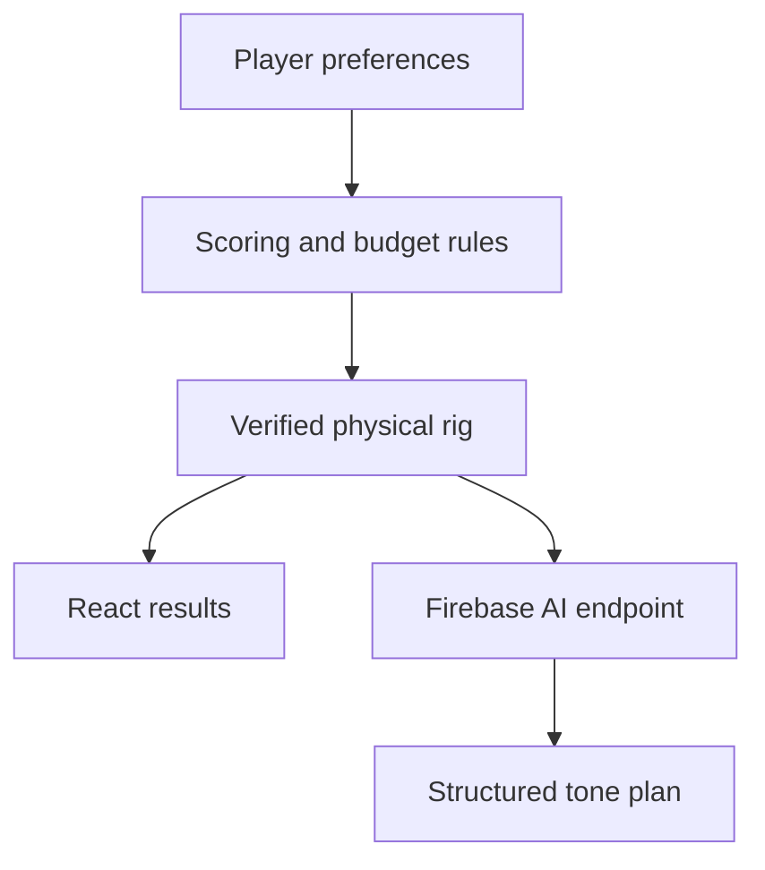

<p align="center">
  
</p>

<p align="center">
  Build a complete guitar or bass rig around your budget, favorite artists, and the sound you want to play.
</p>

<p align="center">
  <a href="https://brutal-rig.web.app"><strong>Live application</strong></a> ·
  <a href="https://github.com/ChristianBarajas/brutal-rig">Source code</a>
</p>

## Find your sound. Build the whole rig.

Building a heavy rig usually means hours of YouTube reviews, forum threads, compatibility checks, and price comparisons. Generic gear lists also miss the details that matter: the player's budget, instrument, favorite bands, preferred brands, shopping preference, and whether every part of the signal chain actually works together.

Brutal Rig compresses that research into one guided workflow. It recommends a complete physical rig, explains each choice, verifies the estimated total, and produces usable starting settings for the exact gear selected. The rig builder remains the main product; Search Gear is a companion place to explore individual products before building a setup.

## The rig builder

- Builds guitar and bass rigs across entry-level, midrange, and professional budgets.
- Supports hardcore, metalcore, death metal, thrash, nu-metal, and doom/sludge tone profiles.
- Scores favorite bands and preferred brands against a curated physical-gear catalog.
- Supports best-value, new-only, and used-first shopping strategies.
- Validates instruments, amplification, tuners, required cables, and head/cab compatibility.
- Keeps the complete recommendation inside the selected budget.
- Explains item-level match scores and the role of every component.
- Generates an AI Rig Tech plan with a signal chain, starting settings, setup notes, and next upgrade priority.
- Supports Google and email/password authentication through Firebase Authentication.
- Saves, reopens, renames, updates, and deletes private user-owned builds in Cloud Firestore.
- Preserves in-progress builder drafts on the current device so a refresh does not erase the workflow.
- Turns tone, featured-build, and brand cards into functional builder presets instead of decorative UI.
- Handles guitar and bass recommendations through the same tested product flow.

Brutal Rig does not sell equipment or process purchases. Catalog prices are estimates; shopping searches lead to external sites where players can verify current prices, shipping, and availability.

## Why the recommendation engine is hybrid

The AI model is not trusted with shopping math, prices, or product compatibility. Those are deterministic software-engineering problems, so the local recommendation engine handles them first.

1. The user submits budget, instrument, tone, band, brand, and shopping preferences.
2. JavaScript scoring rules rank items from the curated catalog.
3. Budget and compatibility rules assemble and validate the complete physical rig.
4. The React results page renders the verified products, prices, and explanations.
5. On request, the server sends only the sanitized, already-verified rig to OpenAI.
6. Structured Outputs return a predictable tone plan that the UI can validate and render.



This separation keeps the core recommendation useful even when the AI service is unavailable and prevents a model response from silently changing the shopping list or budget.

## Accounts and saved rigs

Authentication is optional. Anyone can use the complete recommendation engine and AI Rig Tech without creating an account; sign-in is required only when a user chooses to save a build.

Saved builds use the path `users/{uid}/rigs/{rigId}`. Firestore Security Rules require an authenticated request and verify that the request UID matches the path UID before allowing reads or writes. Each document contains a snapshot of the verified rig, the user's builder preferences, price totals, and the AI tone plan when one has been generated.

Users can:

- Continue a partially completed builder flow from local storage.
- Save a verified rig after signing in.
- Update the saved document after generating a new AI tone plan.
- Open saved builds from a dedicated My Rigs dashboard.
- Rename or permanently delete their own builds.
- Use a saved build's preferences as the starting point for a new recommendation.

## AI Rig Tech integration

AI Rig Tech is a secure server-side feature built with Firebase Cloud Functions and the OpenAI Responses API.

The request includes the generated rig, selected tone, favorite bands, instrument type, budget, total, and remaining budget. The model is instructed to work only with those products and return:

- A short tonal summary
- An ordered signal chain
- Component-specific starting settings with explanations
- Setup and safety notes
- One realistic next-upgrade priority

The response uses a strict JSON schema. Incomplete or malformed output is rejected before it reaches the interface. The client never receives the OpenAI API key and never calls OpenAI directly.

### Production safeguards

- `OPENAI_API_KEY` is stored in Firebase Secret Manager.
- The OpenAI key is restricted to the Responses API and its project is model-limited.
- Requests and generated rigs are sanitized and schema-validated server-side.
- Requests are limited per client before the model is called.
- The function is capped at one instance with low concurrency to control burst cost.
- Prompts prohibit replacements, price changes, unlisted products, and software amp sims.
- OpenAI billing uses a separate project with auto-reload disabled and a hard spend limit.

The current request limiter is intentionally small and in-memory. Before significant public traffic, the next step is Firebase App Check plus a distributed limiter such as Firestore or Redis.

## Search Gear: explore before you build

Search Gear is a companion Next.js application in `storefront/`. It reads the existing curated catalog from `src/data/gear.js` without changing the rig builder's recommendation rules. Players can search by name or description, filter by brand and estimated price, and open a product page to learn about individual guitars, basses, amps, pedals, and essentials. The pages link back to building a complete rig.

Two curated pages explain a classic design and a modern model: the BOSS SD-1 and BOSS Katana-100 Gen 3. Their gear notes include manufacturer sources. Other catalog entries still have useful descriptions and estimated prices, but do not claim to have researched history.

The Katana-100 Gen 3 page also has an optional **Price Scout** experiment. Players can request potential new or used fixed-price eBay listings, see item price and known shipping separately, and open a listing on eBay. Direct Google Shopping and eBay searches remain available when live lookup is not configured. It does not promise the lowest price, current stock across retailers, or a final total including tax. Live results require eBay Production API credentials; automated tests use mocked responses. There is no cart or checkout because Brutal Rig does not sell gear.

Search Gear works locally alongside the main app and needs its own Next.js deployment before it has a public URL. The existing Firebase-hosted Vite rig builder remains the live product. See [`storefront/INTEGRATION.md`](storefront/INTEGRATION.md) for the separate deployment and navigation steps.

### How the search connects

1. React captures a search term, brand, and price range.
2. Apollo Client sends a GraphQL query to the Next.js `/api/graphql` route.
3. GraphQL Yoga validates the request; resolvers read and filter the shared catalog.
4. Apollo renders results or loading, empty, and error states.
5. Next.js serves product detail pages with metadata. The optional offer query runs on the server so eBay credentials stay out of the browser.

## Testing and quality gates

```bash
npm run check
```

The single verification command runs:

- ESLint across the application and function code
- Guitar budget scenarios from $400 to $4,100
- Bass budget scenarios from $500 to $4,100
- New-only, used-first, and best-value pricing scenarios
- A 144-scenario preference matrix across both instruments, all six tones, four budget levels, three shopping modes, and tone-appropriate band influences
- Server request-method and payload validation tests
- Rig sanitization and malformed-rig rejection tests
- Structured AI request and response parsing tests
- Rate-limit behavior tests that confirm the model is not called after a limit
- Local-draft validation and homepage preset parsing tests
- Saved-rig snapshot validation and malformed-data rejection tests
- A complete production build

The same checks run in GitHub Actions on pushes and pull requests.

Verify Search Gear separately with `npm test --prefix storefront` and `npm run build --prefix storefront`. Its tests cover catalog filters, product lookup, curated learning notes, and mocked offer responses; the build generates product routes.

## Run locally

Requirements: Node.js 22+ and npm.

```bash
git clone https://github.com/ChristianBarajas/brutal-rig.git
cd brutal-rig
npm install
npm install --prefix functions
npm install --prefix storefront
```

Run the two apps in separate terminals:

```bash
npm run dev
```

```bash
NEXT_PUBLIC_BRUTAL_RIG_URL=http://localhost:5173 npm run dev --prefix storefront
```

Vite normally uses `http://localhost:5173` and Search Gear uses `http://localhost:3000`. If Vite picks another port, replace `5173` in the Search Gear command.

The deterministic rig builder works without an API key. AI Rig Tech needs the Firebase function or local emulator.

Firebase Hosting serves the production web configuration from `/__/firebase/init.json`. For account features during Vite local development, copy `.env.example` to `.env.local` and fill it with the public Firebase Web App configuration. These values identify the Firebase project; they do not replace Firestore Security Rules and are not server secrets.

For emulator development, copy `functions/.secret.local.example` to `functions/.secret.local`, replace the placeholder, and keep that file private.

For optional live Price Scout lookup, use `storefront/.env.example` to create `storefront/.env.local` with your eBay Production credentials. Keep that file private. The search and product pages work without those credentials.

## Deploy

Cloud Functions deployment requires a Firebase project on the Blaze plan. Store the key server-side and deploy the rig builder and its Firebase backend:

```bash
firebase functions:secrets:set OPENAI_API_KEY
firebase deploy --only firestore:rules,functions,hosting
```

Before exposing an AI endpoint publicly, configure an OpenAI project spend limit and keep automatic credit reload disabled unless ongoing paid usage is intentional.

Search Gear is a separate Next.js runtime and is not included in the static Vite Hosting deployment. Follow [`storefront/INTEGRATION.md`](storefront/INTEGRATION.md) when publishing it.

## Project structure

```text
src/components/builder/       Six-step preference flow
src/components/results/       Verified rig and AI Rig Tech UI
src/components/auth/          Sign-in and account interface
src/auth/                     Authentication state and actions
src/data/                     Curated gear and artist profiles
src/pages/MyRigs.jsx          Private saved-build dashboard
src/pages/SavedRig.jsx        Saved rig detail and update flow
src/recommendation/           Budget, pricing, and scoring rules
src/utils/generateRig.js      Deterministic recommendation orchestration
src/utils/builderDraft.js     Local draft and preset handling
src/services/savedRigs.js     Firestore saved-build operations
src/services/rigTech.js       Client-to-function integration
firestore.rules               User-scoped data authorization
functions/src/rigTechCore.js  AI validation, prompt, schema, and parsing
functions/index.js            Secured Firebase HTTP function
functions/test/               Backend unit tests
scripts/                      End-to-end rig scenarios
storefront/app/                Next.js Search Gear routes and GraphQL endpoint
storefront/components/         Apollo search UI, product visuals, offer UI
storefront/lib/                Shared catalog projection, schema, gear notes, offer lookup
```

## Engineering decisions

- **Deterministic before generative:** prices, products, compatibility, and totals remain auditable.
- **Progressive enhancement:** the product still solves its main problem without AI.
- **Structured AI output:** the UI consumes a contract instead of untrusted free-form text.
- **Server-only secrets:** browser bundles contain no provider credentials.
- **Optional authentication:** accounts add persistence without blocking the core builder.
- **User-owned data:** Firestore paths and rules enforce per-user isolation.
- **Cost-aware infrastructure:** the endpoint has request, instance, concurrency, and account-level spending controls.
- **Physical gear focus:** recommendations build a real-world signal chain rather than defaulting to plugins or amp simulations.

## Roadmap

- Verify real eBay offer responses and exact-model matching before expanding Price Scout beyond one product
- Deploy Search Gear on a separate Next.js host, then configure the live rig builder's link
- Larger professional bass and extended-range guitar catalogs
- Firebase App Check and distributed production rate limiting
- Shareable rig URLs and comparison views
- Password reset, email verification, and account deletion
- Accessibility and device-level end-to-end tests

## Tech stack

| Area | Technology |
| --- | --- |
| Rig builder interface | React 19, React Router, Vite 8, Tailwind CSS 4, Framer Motion |
| Recommendation engine | JavaScript scoring, pricing, and compatibility rules |
| Accounts and saved rigs | Firebase Authentication, Cloud Firestore, Security Rules |
| AI tone plans | Node.js Firebase Cloud Functions, OpenAI Responses API, Structured Outputs |
| Search Gear interface | React 19, Next.js 16 App Router, product pages and SEO metadata |
| Catalog API | GraphQL Yoga, Apollo Client and cache, shared gear catalog |
| Optional offers | eBay Browse API through a server-side GraphQL resolver |
| Hosting and quality | Firebase Hosting for the rig builder; Node test runner, scenario scripts, ESLint, GitHub Actions |

## Developer

Built by **Christian Barajas**, a Computer Science graduate from California State University, Fullerton and a musician who wanted a clearer way to build heavy rigs.

- [GitHub](https://github.com/ChristianBarajas)
- [Live application](https://brutal-rig.web.app)
